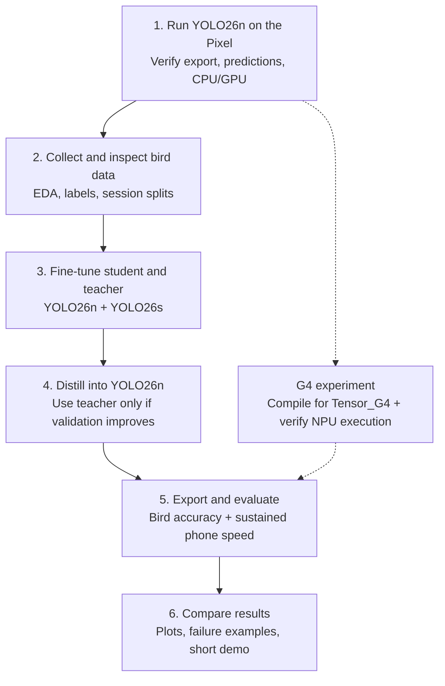

# Bird Detect: concise implementation plan

Status: proposed implementation; app, data pipeline, and models are not built yet. Revised October 10, 2026 to use YOLO26. Target: a Google Pixel 9 Pro, with approximately 20 hours of active work. See the [detailed MVP scope](android_bird_detection_mvp.md) for rationale and source references.

## What we will implement

- A basic Android app that detects one class, `bird`, in live rear-camera video or a local clip, draws boxes and confidence scores, and switches between available models.
- A Python workflow for data inspection, labeling checks, fine-tuning, distillation, export, and evaluation.
- A reproducible comparison of detection quality, sustained phone performance, and model size, with plots and failure examples.
- CPU/GPU benchmarks plus a G4-targeted AOT compilation and TPU deployment experiment.

Use **YOLO26n as the phone student and YOLO26s as the initial teacher**. YOLO26 has mobile export support and a documented same-family distillation path. Fine-tune the teacher on our bird data and confirm it improves validation accuracy before using its guidance. Larger teachers are follow-up experiments. [YOLO26 documentation](https://docs.ultralytics.com/models/yolo26/), [distillation guide](https://docs.ultralytics.com/guides/knowledge-distillation).

Start with a standard YOLO26n ncnn export and C++ inference on CPU, then test Vulkan GPU execution. Reuse the existing YOLOv8 Android example's camera, native bridge, and backend controls where practical; replace its detector decoding for the verified YOLO26 output. Pin dependencies and pass a tiny train/distill/export check before full training. Quantization, NMS-free inference, and a second runtime are extensions. Species recognition, tracking, accounts, and a backend are outside the MVP.

## Flow of work



The G4 branch starts with a pretrained-model smoke test after the CPU baseline works; repeat it for the selected trained student. It can extend the budget and does not block the core accuracy/distillation comparison. If the teacher is not better on validation data, skip distillation and evaluate the ordinary fine-tune.

## App and repository organization

Proposed layout; only the documentation exists today:

```text
android/app/       Android screen, camera/clip input, overlay, model selection
  src/main/cpp/   ncnn inference, preprocessing, decoding, native bridge
ml/               Data preparation, train, distill, export, evaluate, plot scripts
configs/          Dataset, model, training, export, and benchmark settings
notebooks/        Initial EDA and visual label inspection
docs/             Scope, implementation plan, data/annotation conventions
reports/          Curated comparison tables, plots, and findings for the repo
data/             Local raw media, labels, split manifests; ignored
weights/          Local checkpoints and exported models; ignored
outputs/          Generated predictions, metrics, logs, figures; ignored
```

Keep source code and reproducible settings in Git. Record dataset provenance, split IDs, dependency versions, seeds, checkpoint hashes, and export settings. Keep large artifacts local; copy only selected report outputs into `reports/`.

App flow: camera/clip → oriented RGB frame → preprocessing → native inference → box decoding/filtering → preview overlay and timing. Run inference off the UI thread; process the latest frame instead of accumulating a queue. Use a shared model interface and metadata describing each artifact's input/output and class mapping.

## Basic app design

One screen, using standard Android controls:

```text
Bird Detect                  [Camera | Clip]
┌─────────────────────────────────────────┐
│ Camera preview or selected clip         │
│ Bird bounding boxes + confidence        │
└─────────────────────────────────────────┘
Model: [Pretrained / Fine-tuned / Distilled]
Backend: [CPU / GPU]
[Start / Pause]       [Choose clip, in Clip mode]
Status · processed FPS · latest pipeline latency
```

Default to the rear 1× camera. Offer only installed models; expose the teacher for benchmarking when available. Request camera permission when needed and show clear loading, missing-model, or camera-error states. No detections means an unobstructed preview. Benchmark summaries are saved locally; the live timing display is informational.

Enable GPU selection only after device/model checks pass, and display the backend actually used if execution falls back to CPU. Add an NPU option only after hardware execution is verified.

## Data and initial EDA

Start with roughly 500–1,000 annotated public training frames and 200–400 manually checked phone frames across 6–10 clips, including no-bird backgrounds. Prefer frames from the app's capture path. Track public source terms and attribution separately from the repository license.

Inspect source/clip/session counts, frame dimensions, bird counts, bounding-box sizes, negatives, blur, backgrounds, and capture settings. Plot object-size distributions and representative annotated grids. Check missing/corrupt images, invalid boxes, frame/label alignment, and near-duplicate frames. Review assisted labels and annotate missed birds.

Freeze train/validation/test splits by recording session, keeping related clips and all derived frames together. Preserve official public split boundaries. Reserve separate phone sessions for final testing; avoid random frame-level splitting. Define annotation and small/blurred/in-flight slice rules before final evaluation.

## Training, fine-tuning, and distillation

Use 640×640 input throughout the core comparison. Training adapts pretrained weights; training from scratch is outside scope.

| ID | Model and training | Comparison |
| --- | --- | --- |
| A0 | COCO-pretrained YOLO26n; retain bird predictions | Untouched baseline |
| B0 | Fine-tune YOLO26n on public + phone training data | Ordinary student control |
| T0 | Fine-tune YOLO26s on the same data | Larger teacher |
| D0 | Train YOLO26n with labels plus frozen T0 feature guidance | Distilled student |

Use supervised detection losses for B0/T0 and Ultralytics' built-in feature distillation for D0, passing the fine-tuned T0 checkpoint through `distill_model`. Smoke-test the pinned package on a tiny one-class dataset, then export and verify that only the student is deployed. The documented implementation requires the same model family for teacher and student. Proceed with D0 when T0 outperforms B0 on validation data. [Distillation guide](https://docs.ultralytics.com/guides/knowledge-distillation).

Match B0/D0 initialization, split, epochs, optimizer, learning-rate schedule, augmentation, and seed; log the distillation weight and extra training cost. Choose checkpoints and operating thresholds using validation data. Apply augmentation only during training; transform boxes consistently. D0 retains B0's inference architecture and deploys without the teacher. A0 versus B0 does not isolate the benefit of phone data; that claim requires a public-only fine-tuned control.

## Preprocessing, postprocessing, and export

- Store reviewed labels as one-class YOLO boxes: class `0` and normalized center/width/height, with empty labels for negatives.
- Convert camera input to RGB, handle rotation, and letterbox to 640×640. Match channel order and normalization to the verified export; record scale and padding.
- Start with YOLO26's default one-to-many detection head and external CPU non-maximum suppression (NMS). Decode the artifact's actual tensors, apply confidence filtering/NMS, undo letterboxing, and map boxes through preview rotation/scaling. Record the exported tensor names/shapes, box format, score semantics, class mapping, and head choice beside each artifact.
- Replace the example's YOLOv8 raw distribution-focal decoder: YOLO26 removes DFL, so its old 16-bin decoding assumptions do not apply. Verify the standard export rather than manually copying the old conversion edits. Treat the optional NMS-free head (`nms=False`) as a separate accuracy/latency experiment and confirm runtime export support before using it. [YOLO26 output modes](https://docs.ultralytics.com/models/yolo26/).
- Map pretrained COCO bird index `14` and fine-tuned index `0` to the same evaluation class. Record the fine-tuned head change when comparing speed.
- Check Python/native prediction parity on fixed images, including rotated inputs and negatives, before full training. Evaluate exported artifacts as well as checkpoints.

## GPU and NPU experiments

G4 support checked October 9; YOLO26 model/export/distillation support checked October 10, 2026. Keep hardware comparisons separate from A0/B0/T0/D0 training comparisons: change the backend while holding the checkpoint, 640×640 input, detection head, frames, and processing settings constant.

- **GPU, core experiment:** build ncnn with Vulkan support, detect the available GPU, and compare CPU with GPU on A0 and the selected student. Match floating-point settings where supported; test GPU FP16 separately and recheck AP. Record actual precision and any CPU fallback. GPU speedup is a hypothesis; transfers, unsupported layers, and camera/rendering contention can erase it. [ncnn Vulkan guidance](https://github.com/Tencent/ncnn/blob/master/docs/how-to-use-and-FAQ/FAQ-ncnn-vulkan.md).
- **NPU, direct G4 AOT experiment:** compile a compatible YOLO26n `.tflite` export on Linux x86_64 for `SocModel.TENSOR_G4`. Start with `google_tensor_truncation_type="half"` and `google_tensor_sharding_intensity="maximum"`, the Google-maintainer recipe for a G4 YOLO compilation issue. The compiler exposes G4 even though the top-level SDK support list names newer chips. Start with a known-good vision model, then pretrained YOLO26n before full training. The reported detector compilation was YOLO11n; YOLO26 G4 compilation and execution remain unverified. Repeat the check on the selected trained export. [G4 target source](https://github.com/google-ai-edge/LiteRT/blob/main/litert/python/aot/vendors/google_tensor/target.py), [G4 compiler/runtime recipe](https://github.com/google-ai-edge/LiteRT/issues/7598).
- **NPU deployment gate:** obtain authentic compiler and Google Tensor dispatch libraries and pin a tested combination. A Google engineer confirmed compiler 2.1.5 with LiteRT/runtime libraries 2.1.1 and a compatible public OTA on a G4 Pixel. Verify availability and compatibility on this Pixel 9 Pro, package `libLiteRtDispatch_GoogleTensor.so`, and prove TPU execution. Save compilation coverage and device execution logs, check prediction parity/AP after half-precision compilation, and include CPU decoding/NMS or partial delegation in timing. Compilation success alone is not an on-device result; NNAPI is not the first route.
- **Optional runtime comparison:** export the same checkpoint to LiteRT, verify parity, and benchmark its CPU and GPU paths as a pair. Comparing LiteRT with ncnn measures a whole-system change. LiteRT's documented Interpreter GPU delegate runs quantized models through floating-point execution; INT8 storage alone does not establish integer GPU acceleration. [GPU delegate behavior](https://developers.google.com/edge/litert/performance/gpu).

Reuse the existing warm-up and five-minute trials; include GPU synchronization, transfer overhead, and early/late throughput. Record thermal state and instrumented energy per frame if available. Use sustained pipeline p95 and AP to select a backend. LiteRT/NPU exploration may extend the original 20-hour budget.

## Evaluation and result visualization

Detection quality: report AP50 (IoU 0.50), AP50–95 (averaged over IoU 0.50–0.95 in 0.05 steps), precision/recall at a validation-selected operating threshold, and false positives per 100 frames. Compute AP using a low score floor and a confidence sweep. Score all frozen test frames in original-image coordinates, including negatives; report public and phone results separately plus small/blurred/in-flight slice counts.

Phone performance: use release builds, fixed backend/precision/threads, identical replay clips, warm-up, and approximately five-minute trials. Report preprocessing/inference/postprocessing timing, total pipeline p50/p95, processed FPS, dropped frames, model bytes, and app memory. Alternate model order under comparable thermal conditions. Fix success targets before inspecting test results; do not treat single-run gains as established significance.

Save per-frame predictions, aggregate metrics, benchmark records, and run metadata. Produce:

- EDA distributions and annotated sample grids.
- Training/validation loss and validation AP curves.
- Precision–recall curves and an A0/B0/T0/D0 comparison table.
- AP50 versus p95 latency scatter plot, annotated with model size.
- CPU/GPU comparison for the same checkpoint, with backend/precision labels and throughput over time; include NPU only if verified.
- Side-by-side ground truth/predictions for blur, tiny birds, and confusing negatives.

Implementation order: verify YOLO26n phone CPU/GPU baseline, export parity, and tiny distillation run → inspect/label data and freeze splits → evaluate A0 and fine-tune B0/T0 → distill D0 when the teacher qualifies → integrate and benchmark exports/backends → prepare the report and a short demo. Start the separate G4 smoke test after CPU bring-up and repeat it on the selected trained export. Keep the core comparison within the approximate 20-hour budget; G4 bring-up and additional head/runtime experiments may need more time.

First 2–3 hours: obtain a working YOLO26n CPU camera baseline and prediction parity on fixed images. If native integration stalls, reduce the app shell or try the same YOLO26n checkpoint through LiteRT CPU, recording the runtime change and establishing new paired CPU/GPU controls before training. If teacher quality blocks distillation, deliver the measured baseline/fine-tuning comparison and document the limitation.
